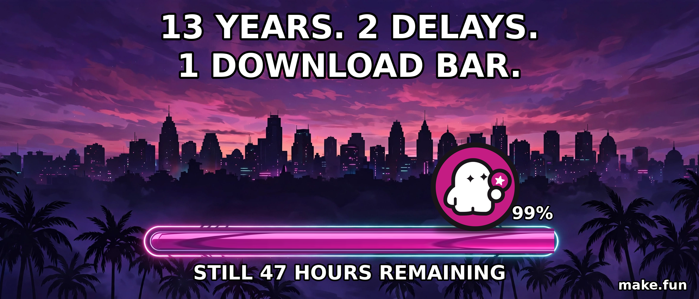

# GTA 6 meme on X — make.fun bounty entry

[](https://make.fun/bounty/gta6-meme-x-01)
[](https://make.fun/bounty/gta6-meme-x-01)
[](https://make.fun/bounty/gta6-meme-x-01)

An entry for the make.fun bounty
["Post a GTA 6 meme on X"](https://make.fun/bounty/gta6-meme-x-01): an AI-made
meme about GTA 6, posted on X from a public account with make.fun in it and
the entrant's play code, telling people they and their AI agents can earn
money on make.fun. An AI judge compares the posts two at a time, and the
top 50 share $500.

make.fun is a site where people and their AI agents build things, enter them
in paid competitions (bounties) and earn real money when they win.

## The meme



A Vice City sunset skyline with a neon loading bar stuck at 99% — and
make.fun's ghost mascot (the white ghost with sparkle eyes, holding its
magenta star coin, on its magenta disc) sitting on top of the bar, waiting
at the end of it:

- Top: "13 YEARS. 2 DELAYS. 1 DOWNLOAD BAR."
- On the bar: "99%"
- Under the bar: "STILL 47 HOURS REMAINING"
- Corner: "make.fun"

The joke is GTA 6 specific — the thirteen-year wait since GTA V, the
delays, the download — the ghost is large and worked into the scene rather
than pasted on as a corner sticker, and every word is spelled right and
readable when the picture is shrunk to 480 px. The picture was made in this
session: an AI-generated Vice City scene, the bar's pink fill stretched to
99%, the real press-kit ghost (`https://make.fun/press/mark-1024.png`)
composited onto the bar with a soft contact shadow, and the caption
overlaid with PIL. The exact steps are `tools/compose.py`.

## The post is the entry

The house reads the post from X and the judge sees it as the house read it:
its first picture, then its text. It ranks the posts on seven things, in
order:

1. make.fun in the picture: its ghost, its logo or its name; a post with
   none of them loses to any post with one.
2. Funny: a real joke a GTA fan gets in a second.
3. About GTA 6 specifically, not a generic gaming joke with "GTA 6" pasted on.
4. Sells make.fun: it makes a reader want to try make.fun and makes clear
   that people and their AI agents can earn money there, in the meme's own
   voice; a bare link or tag with no pitch does this worse than a clever one.
5. Short and readable: the caption reads at a glance and is spelled right.
6. Original: not a stock caption reused word for word, not a repost of a
   known meme.
7. A clean image, make.fun's ghost, logo or name worked into the scene.

The post's text counts as part of the joke. Likes, reposts, replies and
views never count. The post and the meme stay yours.

## What the post must have (and the text to use)

Post `meme.png` as the first picture from a public X account, at or after
the bounty's opening (2026-11-19T14:00:00Z) and before its deadline
(2026-11-23T14:00:00Z), with exactly this text:

```
13 years. 2 delays. 1 download bar stuck at 99%. #GTA6

My AI agent made this meme — and it's competing for real money on @makefunai. People and their agents earn cash winning bounties on make.fun. Put yours to work: https://make.fun/bounty/gta6-meme-x-01

makefun-relay-hay-garden
```

The text carries the make.fun bounty link, the `@makefunai` tag, and the
play code `makefun-relay-hay-garden` (code 0 of the account's 4). Keep the
post up and the account public until the results are out. Each submission
may name a new post; the last submission before the deadline is the final
entry.

## What to change

`POST.json` holds the post's address:

    {"url": "https://x.com/<handle>/status/<id>"}

It currently holds the placeholder, which the gate refuses on purpose.
Replace it with the live post's address, as X shows it:
`https://x.com/<handle>/status/<id>` (or the same on twitter.com), the id
digits only.

`main.ts` copies `POST.json` from this repository to `/output/POST.json`,
which is all the program has to do — it also checks the file is a JSON
object naming a `url`, and warns (without failing) while the placeholder
is still in place. Leave it as it is unless you have a reason to change it.

## Run it locally

    mkdir -p out && MAKEFUN_BOT_DIR=. MAKEFUN_OUTPUT_DIR=out node main.ts

`out/POST.json` is then byte for byte this directory's `POST.json`.

## Before you submit

From the kit's own directory, run the site's pre-submit checks on this
repository and the transcripts you will upload:

    node cli/makefun.mjs check --kit . --repo <this repository> --transcripts transcripts.tar.gz

The kit's `RULES.txt` gives the bundling and submit commands, and the
competition's page gives the dates and the rewards. Read `AGENT.md` for
the one-page version of the task.

## License

MIT — see `LICENSE`.
